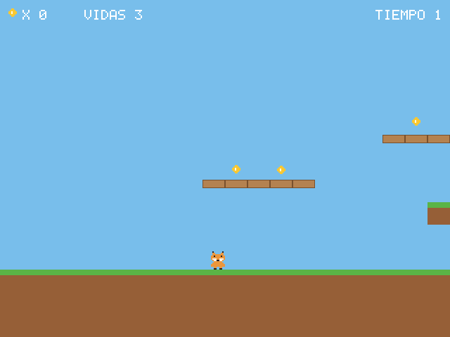
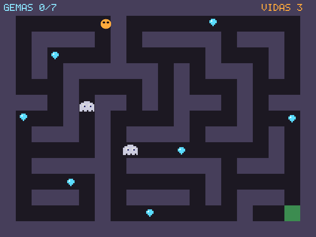
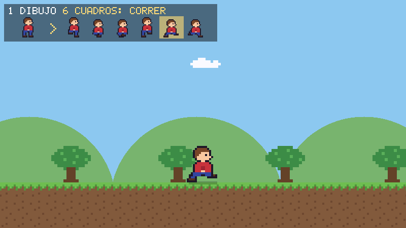

<div align="center">

# 🐆 Lince

**Un lenguaje para hacer videojuegos, en español**

*Perspicaz · Preciso · Para todos*

---

[](LICENSE)
[]()
[]()
[]()

[🌐 Web](https://arreina.github.io/lince) · [🎮 Tu primer juego](https://arreina.github.io/lince/tutorial.html) · [📖 Manual](https://arreina.github.io/lince/manual.html)

</div>

---

Lince es un lenguaje de programación **para videojuegos**, **escrito en C puro** y **sin dependencias para compilarlo**, diseñado para que crear juegos en español sea natural, claro y accesible. La ventana, el dibujo, el teclado y el sonido vienen incluidos (SDL2, que se carga al abrir la ventana).

```lince
importar "juego"

juego.abrir("Mi primer juego", 800, 600)
sea x = 100

mientras juego.abierto() {
    si juego.tecla("derecha") { x = x + 300 * juego.dt() }
    si juego.tecla("izquierda") { x = x - 300 * juego.dt() }

    juego.limpiar([20, 20, 30])
    juego.circulo(x, 300, 20, "#ffc850")
    juego.texto("Flechas para mover", 10, 10, 3)
    juego.presentar()          # muestra, espera a 60 fps y lee el teclado
}
```

Diez minijuegos completos (Pong, serpiente, rompeladrillos, pájaro saltarín, esquiva, memoria, tres en raya, un plataformas con cámara y sprites, una mazmorra de tiles con fantasmas que te persiguen y un paseo con animaciones generadas a partir de un solo dibujo) están en [`examples/`](examples/).

<p align="center">
  
  
  
</p>

## ¿Por qué Lince?

- **En español** — la programación no debería requerir saber inglés
- **Hecho para juegos** — ventana, dibujo 2D, imágenes y sprites, mapas de tiles, animaciones, partículas, escenas, texto, teclado, ratón, mando, sonido (WAV y OGG), cámara y colisiones en un solo módulo (`juego`)
- **Recarga en caliente** — guarda el archivo con el juego en marcha y se actualiza sin cerrar la ventana, con el jugador donde estaba; si hay un error, sale en la propia ventana
- **Sin dependencias para compilar** — un solo binario, compilado con `gcc` y `make` (SDL2 se carga al abrir la ventana)
- **Errores claros** — mensajes literales con número de línea exacto
- **Ejecutables autónomos** — `lince compilar` empaqueta tu programa en un único ejecutable, y `lince repartir` prepara un `.zip` con el juego y SDL2 para pasárselo a quien sea

## Instalación

### Descargar

En [Versiones](https://github.com/arreina/lince/releases/latest) está Lince ya compilado para Linux (`lince-X.Y.Z-linux.tar.gz`) y para Windows (`lince-X.Y.Z-windows.zip`, con SDL2 dentro). Se descomprime y se usa: `lince examples/01_pong.lince`. En Linux, para abrir ventanas hace falta SDL2 (`sudo apt install libsdl2-2.0-0`). Lo que ha cambiado en cada versión está en [NOVEDADES.md](NOVEDADES.md).

### Compilarlo en Linux

```bash
git clone https://github.com/arreina/lince.git
cd lince
make
sudo make install   # opcional
sudo apt install libsdl2-2.0-0   # para abrir ventanas
```

### Compilarlo en Windows (MSYS2, terminal UCRT64)

```bash
pacman -S mingw-w64-ucrt-x86_64-gcc make mingw-w64-ucrt-x86_64-SDL2
git clone https://github.com/arreina/lince.git
cd lince && make
```

Desde Linux también se puede crear `lince.exe` con `make windows` (necesita MinGW).

### Compartir un juego

```bash
lince repartir mi_juego.lince
```

Crea la carpeta `mi_juego-linux` (o `mi_juego-windows`) y un `.zip` con ella: el juego con sus imágenes y sonidos dentro, SDL2 y un `LEEME.txt`. Quien lo reciba lo descomprime y juega, sin instalar Lince. Las imágenes y sonidos que nombra el código van dentro solos; los niveles u otros archivos, con `--incluir`.

### En un móvil Android

```bash
lince repartir mi_juego.lince --android --nombre "Mi juego"
```

Hace `mi_juego.apk`, para instalar el juego en un móvil Android, sin instalar nada más (Lince lo monta y lo firma él mismo a partir de la plantilla `lince-android.apk`, que viene con cada versión): a pantalla completa, con un mando en la pantalla como el de los juegos de móvil (`juego.mando_tactil()`: palanca y botones A/B que funcionan como un mando de verdad), `juego.toques()` y el botón «atrás» para salir. Ver [`android/LEEME.md`](android/LEEME.md).

## Uso

```bash
lince programa.lince              # ejecutar
lince nuevo mi_juego              # crear un juego nuevo listo para cambiarlo
lince compilar programa.lince     # crear un ejecutable autónomo
lince repartir juego.lince        # carpeta y .zip para compartir el juego
lince depurar programa.lince      # depurar paso a paso
lince comprobar programa.lince    # sólo comprobar la sintaxis
lince lsp                         # servidor de lenguaje para tu editor
lince                             # REPL interactivo
lince instalar https://github.com/usuario/paquete
lince ayuda
```

## El lenguaje

### Variables y tipos

```lince
sea nombre = "Ana"
fijo PI = 3.14159
sea lista notas = [9, 7, 10]
sea diccionario config = {"debug": verdadero, "version": 2}
```

### Funciones y closures

```lince
funcion factorial(val numero n): numero {
    si n <= 1 { devolver 1 }
    devolver n * factorial(n - 1)
}

# Valores por defecto
funcion saludar(val texto nombre, val texto saludo = "Hola"): texto {
    devolver saludo + ", " + nombre
}

# Closures
funcion multiplicador(val numero factor): funcion {
    devolver funcion(val numero x): numero { devolver x * factor }
}
sea doble = multiplicador(2)
escribir(doble(5))   # 10
```

### Clases, herencia e interfaces

```lince
interfaz Forma {
    funcion area(): numero
}

clase Rectangulo implementa Forma {
    funcion crear(val numero ancho, val numero alto): nulo {
        mi.ancho = ancho
        mi.alto  = alto
    }
    funcion area(): numero { devolver mi.ancho * mi.alto }
}

clase Cuadrado extiende Rectangulo {
    funcion crear(val numero lado): nulo {
        padre(lado, lado)
    }
}
```

### Generadores

```lince
generador pares(val numero hasta): numero {
    para cada numero n en rango(hasta) {
        si n % 2 == 0 { producir n }
    }
}

para cada numero n en pares(10) {
    escribir(n)   # 0, 2, 4, 6, 8
}
```

### Tareas

Código que se para a esperar sin parar el juego: lo que pasa a lo largo del tiempo
se escribe en orden.

```lince
tarea ataque_jefe() {
    jefe.animar("cargar")
    esperar(0.8)              # solo se para esta tarea; el juego sigue
    para (i = 0; i < 3; i++) {
        disparar(jefe.x, jefe.y)
        esperar(0.2)
    }
}

ataque_jefe()                 # empieza ya y sigue sola en cada juego.presentar()
```

### Enumeraciones

```lince
enumeracion Color { Rojo Verde Azul }

sea c = Color.Rojo
elegir c {
    caso Color.Rojo  { escribir("rojo") }
    caso Color.Verde { escribir("verde") }
    otro             { escribir("otro") }
}
```

### Manejo de errores

```lince
intentar {
    sea datos = json.parsear(archivos.leer("partida.json"))
    escribir(datos["version"])
} capturar (ErrorRango e) {
    escribir("Clave no encontrada: " + e.mensaje)
} capturar (error e) {
    escribir("Error: " + e.mensaje)
} finalmente {
    escribir("Listo")
}
```

### Módulos

```lince
importar "matematica"
importar "archivos"
importar "json"

escribir(matematica.raiz(144))                          # 12
archivos.escribir("partida.json", json.texto({"nivel": 3}))
```

**Módulos disponibles:** `juego` (ventana, dibujo, sprites, entrada, mando, sonido) · `matematica` · `texto` · `archivos` · `tiempo` · `sistema` · `json` (partidas guardadas) · `pruebas`

## Ejecutables autónomos

```bash
lince compilar programa.lince
./programa
```

`lince compilar` crea un único ejecutable con tu programa, los archivos que importa y las imágenes y sonidos que nombra dentro (con `--incluir`, también niveles u otros archivos): se puede copiar a otra máquina sin instalar Lince; solo hace falta SDL2 si el juego abre una ventana. Soporta el 100 % del lenguaje y tarda milisegundos, porque el ejecutable lleva el propio intérprete.

**Rendimiento** (`make bench`, en segundos): `fib(30)` 0,3 · bucle de 5 millones de iteraciones 0,5 · diccionario de 50.000 claves 0,04.

## Tests

```bash
make test                              # tests del intérprete
make test-compilador                   # tests de los ejecutables
make test-todo                         # todo: minijuegos, módulo juego, editores, LSP, depurador y AddressSanitizer
```

```
✅ 38/38 tests del intérprete pasaron
✅ 15/15 tests del compilador pasaron
```

## Soporte para editores

| Editor | Resaltado | Snippets |
|--------|-----------|----------|
| VSCode | ✅ | ✅ |
| Sublime Text | ✅ | ✅ |
| Notepad++ | ✅ | — |

Instrucciones en [`editores/README.md`](editores/README.md).

## Estructura del proyecto

```
lince/
├── src/                    # código fuente en C
│   ├── main.c              # CLI y subcomandos
│   ├── lexer.c/h           # análisis léxico
│   ├── parser.c/h          # análisis sintáctico
│   ├── interprete.c/h      # evaluación
│   ├── corrutina.c/h       # una pila para cada tarea
│   ├── empaquetado.c/h     # lince compilar: crea ejecutables autónomos
│   ├── repartir.c/h        # lince repartir: carpeta y .zip para compartir un juego
│   ├── recarga.c/h         # recarga en caliente
│   ├── modulos.c/h         # módulos estándar
│   ├── juego.h             # módulo juego (SDL2 cargada en tiempo de ejecución, mezclador de sonido)
│   ├── repl.c/h            # REPL con historial
│   └── paquetes.c/h        # gestor de paquetes
├── tests/
│   ├── runner.lince               # tests del intérprete
│   ├── runner_compilador.lince    # tests de los ejecutables
│   ├── lince/                     # tests del intérprete
│   ├── compilador/                # tests del compilador
│   └── juego/                     # tests del módulo juego y de los minijuegos
├── examples/               # diez minijuegos
├── editores/               # soporte para editores
├── ESPECIFICACION.md       # especificación completa
└── Makefile
```

## Licencia

MIT — libre para usar, modificar y distribuir.

---

<div align="center">

*🐆 Lince — ágil, preciso, para hacer juegos*

</div>
